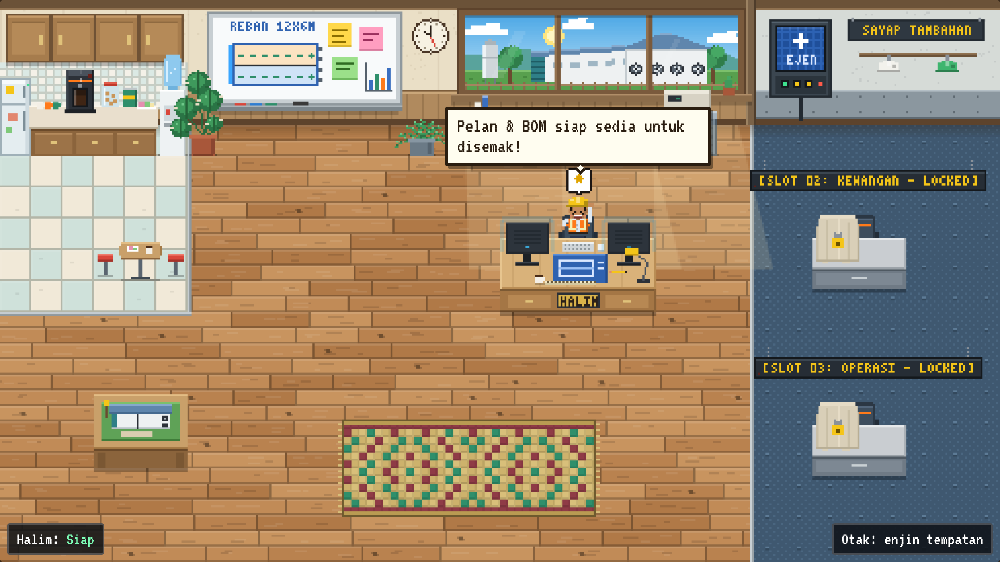

# FarmOS Localhost

Pejabat maya piksel 16-bit dan pusat kawalan reban ayam tertutup. Ejen pertama ialah **Halim**, perancang pembinaan reban dan biosekuriti. Semua berjalan di komputer anda: laman di `http://localhost:3000`, API di `http://localhost:5000`, data dalam `data/farmos.db`.



## Mula

Perlu [Node.js](https://nodejs.org) versi 22.5 atau lebih baharu.

```bash
npm install
```

```bash
npm run dev
```

Kemudian buka http://localhost:3000. Di Windows, boleh juga klik dua kali `mula.bat`.

Perintah lain:

| Perintah | Guna |
|---|---|
| `npm run dev` | Jalankan API (5000) dan laman (3000) bersama |
| `npm start` | Bina laman dan hidangkan semuanya dari `http://localhost:5000` |
| `npm test` | Ujian API dan pengiraan |

## Otak Halim

Tanpa apa-apa tetapan, Halim menjawab guna **enjin tempatan** (luar talian, tiada internet atau kunci). Untuk jawapan LLM, salin `.env.example` kepada `.env` dan isi satu kunci:

- `ANTHROPIC_API_KEY` untuk Claude (berbayar ikut token)
- `GEMINI_API_KEY` untuk Gemini (ada peringkat percuma)

Jika LLM gagal (kunci salah, tiada internet), Halim jatuh semula ke enjin tempatan dan sebabnya ditulis dalam log aktiviti. Halim tidak mengira harga dalam mana-mana mod.

## Struktur

```
farmos-localhost/
├─ package.json            skrip dan kebergantungan
├─ .env.example            contoh tetapan LLM dan port
├─ mula.bat                pelancar Windows
├─ index.html, vite.config.js
├─ shared/
│  └─ farm.js              pengiraan kejuruteraan (kapasiti, kipas, pad, BOM, jadual), dikongsi pelayan dan pelayar
├─ server/
│  ├─ index.js             titik mula pelayan
│  ├─ app.js               laluan API, kerja "hantar data", acara langsung (SSE), muat naik foto
│  ├─ db.js                SQLite (node:sqlite): projek, tugasan, log, sembang, foto, ejen
│  ├─ halim.js             prompt Halim, sambungan Claude/Gemini, enjin tempatan luar talian
│  ├─ agents.config.js     daftar ejen (tambah ejen di sini)
│  └─ app.test.js          ujian
├─ src/
│  ├─ App.jsx, useFarm.js, main.jsx, index.css
│  ├─ components/          panel data, tugasan, pelan lantai, BOM, jadual, sembang, terminal ejen
│  └─ office/              enjin pejabat piksel
│     ├─ Office.js         gelung permainan, watak, rutin harian, zarah, klik
│     ├─ sprites.js        helaian sprite watak dijana prosedur
│     ├─ scene.js          perabot, tingkap ladang, pencahayaan siang/malam
│     ├─ map.js            jubin halangan, stesen kerja, zon klik
│     ├─ path.js           pathfinding A*
│     └─ gfx.js            alat lukis piksel dan fon bitmap
└─ data/                   dicipta sendiri: farmos.db dan uploads/ (foto tapak)
```

## API

| Kaedah | Laluan | Fungsi |
|---|---|---|
| GET | `/api/state` | Semua keadaan: projek, tugasan, log, sembang, ejen |
| PUT | `/api/project` | Simpan data projek |
| POST | `/api/submit` | Hantar data kepada Halim (jalankan 5 tugas) |
| POST | `/api/agent/halim` | Sembang: `{ "message": "...", "photoId": 1 }` |
| POST | `/api/upload` | Muat naik foto tapak (medan `photo`) |
| GET | `/api/export/bom.csv`, `/api/export/bom.md` | Muat turun BOM |
| POST | `/api/agents/:id/activate`, `/lock` | Buka atau kunci slot ejen |
| POST | `/api/agents/halim/status` | Status daripada ejen luar |
| GET | `/api/events` | Acara langsung (SSE) |

### Sambung ejen luar (contoh Hermes)

Ejen lain di komputer yang sama boleh menggerakkan Halim dalam pejabat. Status: `bekerja`, `siap`, `amaran`, `santai`.

```bash
curl -X POST http://localhost:5000/api/agents/halim/status -H "content-type: application/json" -d "{\"status\":\"bekerja\",\"message\":\"Mengira exhaust fan...\"}"
```

## Tambah ejen baharu

Tambah satu objek dalam `server/agents.config.js` dan mulakan semula pelayan:

```js
{ id: 'kewangan', slot: 2, name: 'Aina', role: 'KEWANGAN', title: 'Kewangan dan bajet',
  status: 'active', brain: 'generic', palette: { helmet: '#f2f2ec', vest: '#2f7dd1' } }
```

Meja slot itu dibuka dan watak piksel baharu masuk ke pejabat. Pejabat ada tiga stesen kerja; stesen keempat ditambah dalam `src/office/map.js`. `brain: 'generic'` hanya memberi rutin pejabat. Enjin sembang dan tugasan untuk ejen baharu perlu ditulis dalam `server/`.

## Petua

- Tambah `?jam=22` pada alamat laman untuk lihat pejabat pada waktu lain (0 hingga 24).
- "Set semula data" memadam log, sembang dan foto.
- Angka pengudaraan ialah anggaran awal ikut halaju sasaran 2 m/s. Sahkan dengan pembekal sebelum membeli.
